# Kubo Reservation System — System Flowcharts (Mermaid)

Companion to `docs/system_flowcharts.drawio` and `docs/business_rules.md`.

- **Terminology:** *kubo* = accommodation unit, *kubo type* = accommodation category.
- **Rule references** such as `BR-031` point to `docs/business_rules.md`.
- **Database note:** Availability is derived from `reserved_kubo` date ranges. The
  diagrams assume the checks and writes run in one transaction (BR-032, BR-071).

---

## 1. Overall System Flow

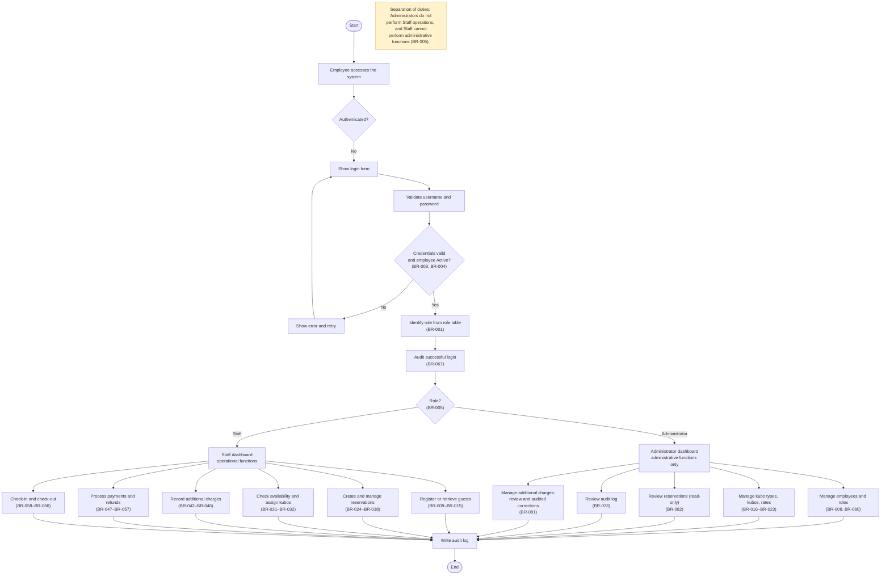

---

## 2. Reservation and Booking Flow (Staff)

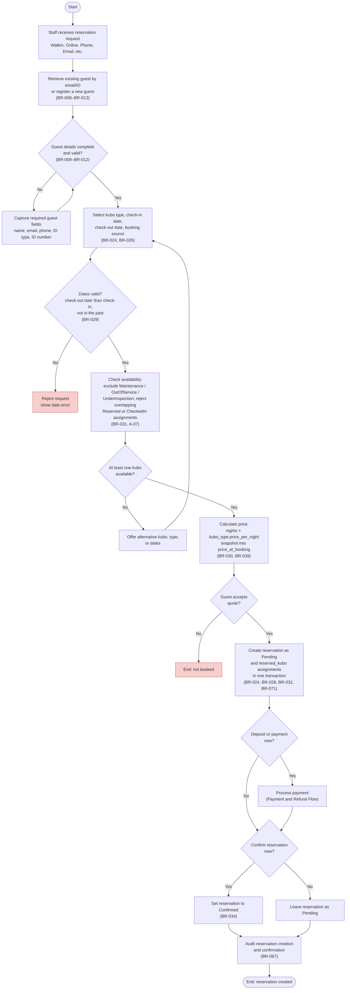

---

## 3. Reservation Management Flow (Staff)

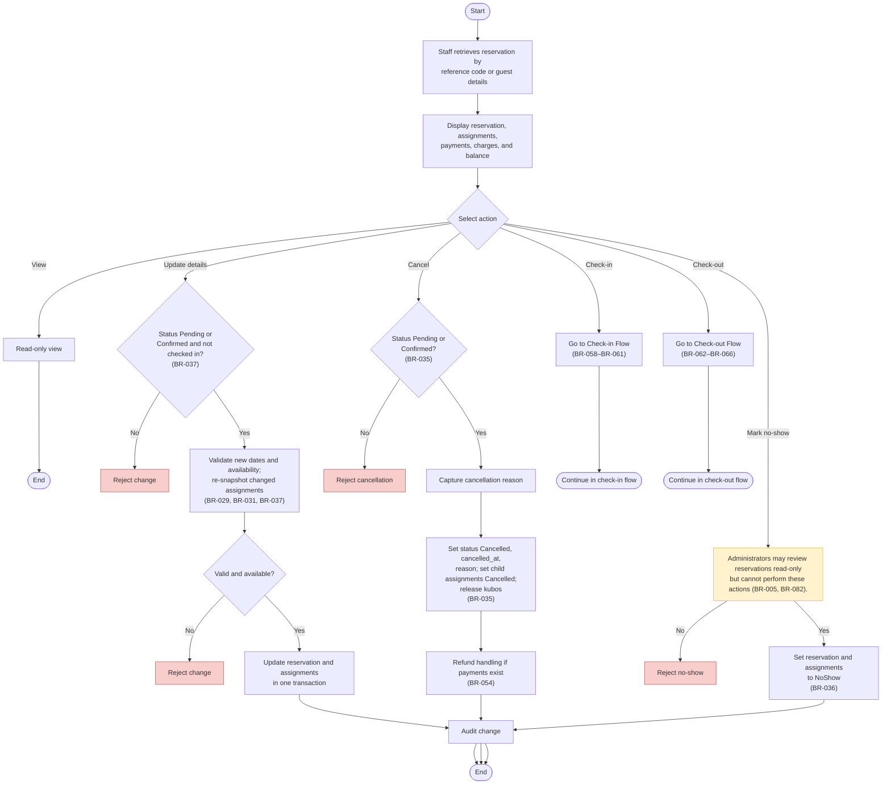

---

## 4. Kubo and Kubo Type Management Flow (Administrator)

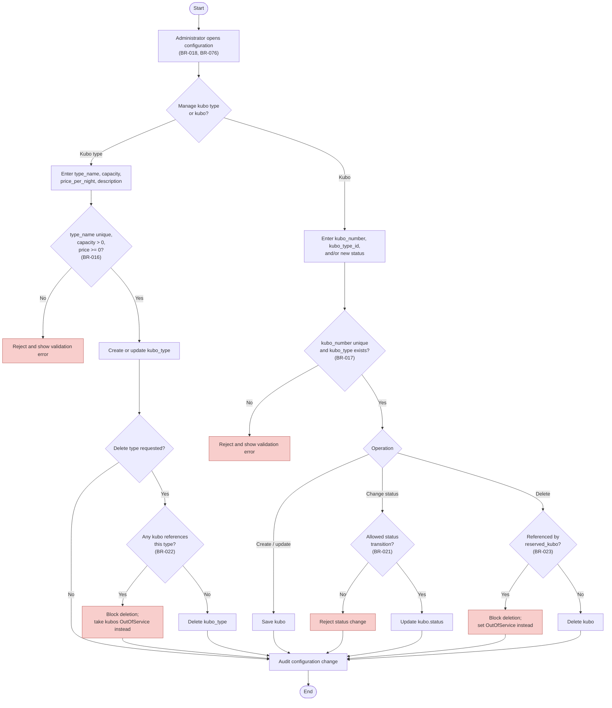

---

## 5. Rate and Pricing Management Flow (Administrator)

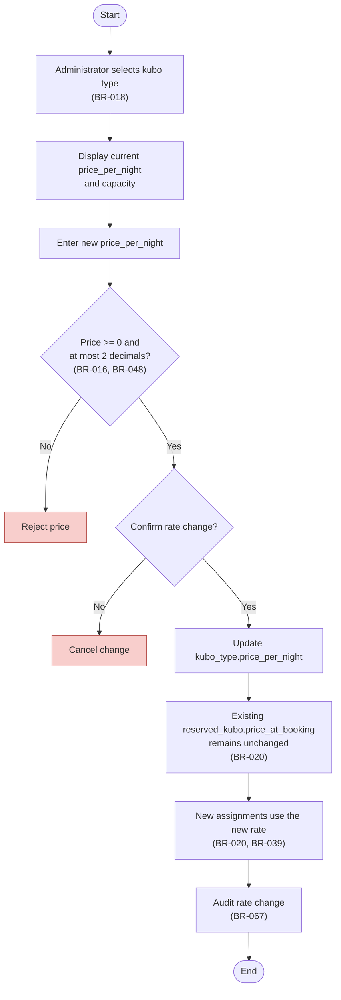

---

## 6. Manage Employees and Roles Flow (Administrator)

Administrators create and maintain employee accounts and roles. The flow enforces
required data, username uniqueness, credential handling, status rules,
last-Administrator protection, and referential deletion restrictions (BR-080).
Password material is never returned or logged (BR-003, BR-070).

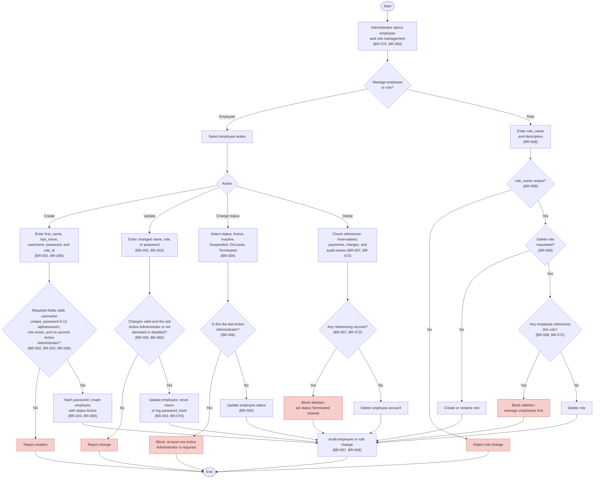

---

## 7. Payment and Refund Flow (Staff)

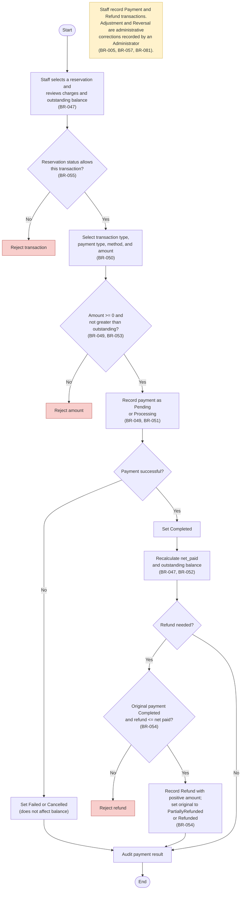

---

## 8. Additional Charge Flow (Staff)

Records extra bill items (extra bed, damage, late check-out, etc.) against an existing
reservation. Charges are stored in `additional_charge` and are separate from `payment`
transactions (BR-042–BR-047). The charge insert, balance recomputation, and audit write
must run in one transaction (BR-071). Operational charge entry is performed by Staff;
Administrators handle corrections through the next flow (BR-005, BR-081).

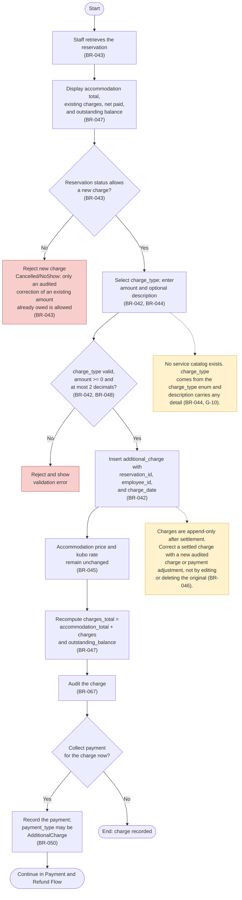

---

## 9. Additional Charge Management Flow (Administrator)

Administrators review charges across reservations and record audited corrections.
Existing charges are append-only: an increase is a new `additional_charge`, while a
reduction must use an `Adjustment` or `Reversal` payment transaction (BR-046, BR-057,
BR-081). Administrative corrections do not replace Staff operational charge entry.

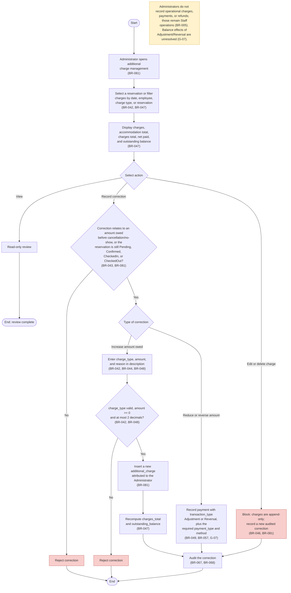

---

## 10. Check-in and Check-out Flow (Staff)

```mermaid
flowchart TD
    subgraph CheckIn["Check-in"]
        S1([Start]) --> P1["Staff retrieves reservation<br/>and assignment"]
        P1 --> D1{"Reservation Confirmed?<br/>(BR-058)"}
        D1 -->|No| E1["Reject check-in"]
        D1 -->|Yes| D2{"Current date is check-in date,<br/>or early check-in approved?<br/>(BR-059)"}
        D2 -->|No| P2["Request early check-in approval"]
        P2 --> D2
        D2 -->|Yes| D3{"Kubo status Available<br/>or Reserved?<br/>(BR-061)"}
        D3 -->|No| E2["Reject check-in;<br/>resolve kubo status"]
        D3 -->|Yes| P3["Record actual_check_in_datetime;<br/>set assignment CheckedIn;<br/>set kubo Occupied<br/>(BR-060)"]
        P3 --> D4{"First assignment<br/>checked in?"}
        D4 -->|Yes| P4["Set reservation CheckedIn"]
        D4 -->|No| P5["Keep reservation CheckedIn"]
        P4 --> P6["Audit check-in"]
        P5 --> P6
        P6 --> E3([End: checked in])
    end

    subgraph CheckOut["Check-out"]
        S2([Start]) --> P7["Staff retrieves checked-in assignment"]
        P7 --> D5{"Assignment CheckedIn?<br/>(BR-062)"}
        D5 -->|No| E4["Reject check-out"]
        D5 -->|Yes| D6{"Outstanding balance zero?<br/>(BR-064, A-04)"}
        D6 -->|No| P8["Record final charges and<br/>process payment"]
        P8 --> D6
        D6 -->|Yes| P9["Record actual_check_out_datetime;<br/>set assignment CheckedOut;<br/>set kubo Cleaning/Available<br/>(BR-063)"]
        P9 --> D7{"All assignments terminal?"}
        D7 -->|Yes| P10["Set reservation CheckedOut"]
        D7 -->|No| P11["Keep reservation CheckedIn"]
        P10 --> P12["Audit check-out"]
        P11 --> P12
        P12 --> E5([End: checked out])
    end

    style E1 fill:#f8cecc,stroke:#b85450
    style E2 fill:#f8cecc,stroke:#b85450
    style E4 fill:#f8cecc,stroke:#b85450
```

---

## 11. Status Lifecycles

### 11.1 Reservation status

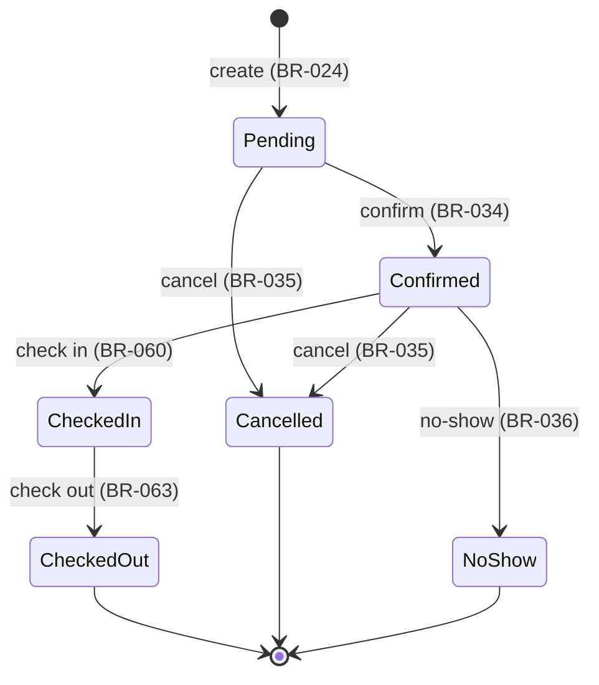

### 11.2 Reserved-kubo assignment status

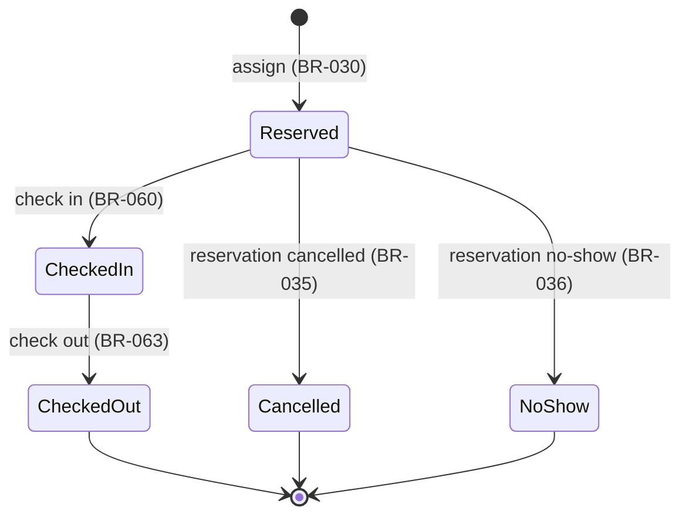

### 11.3 Payment status

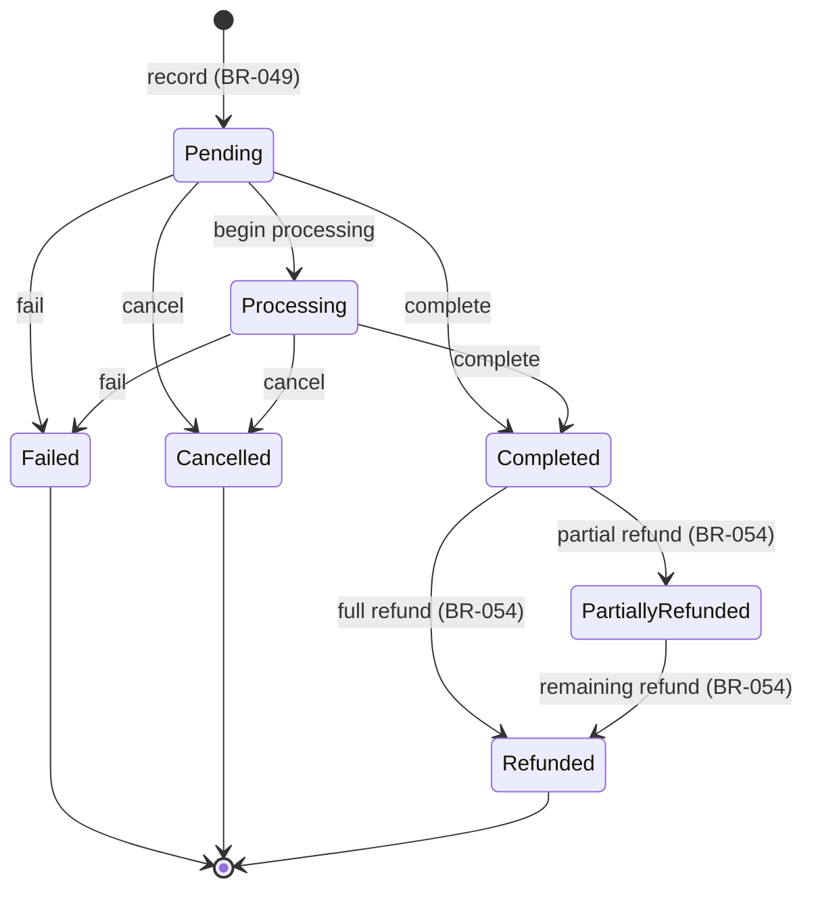

### 11.4 Kubo operational status

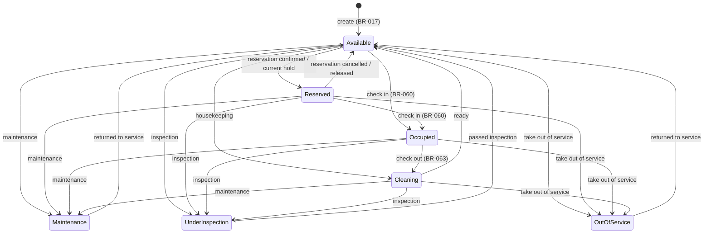
